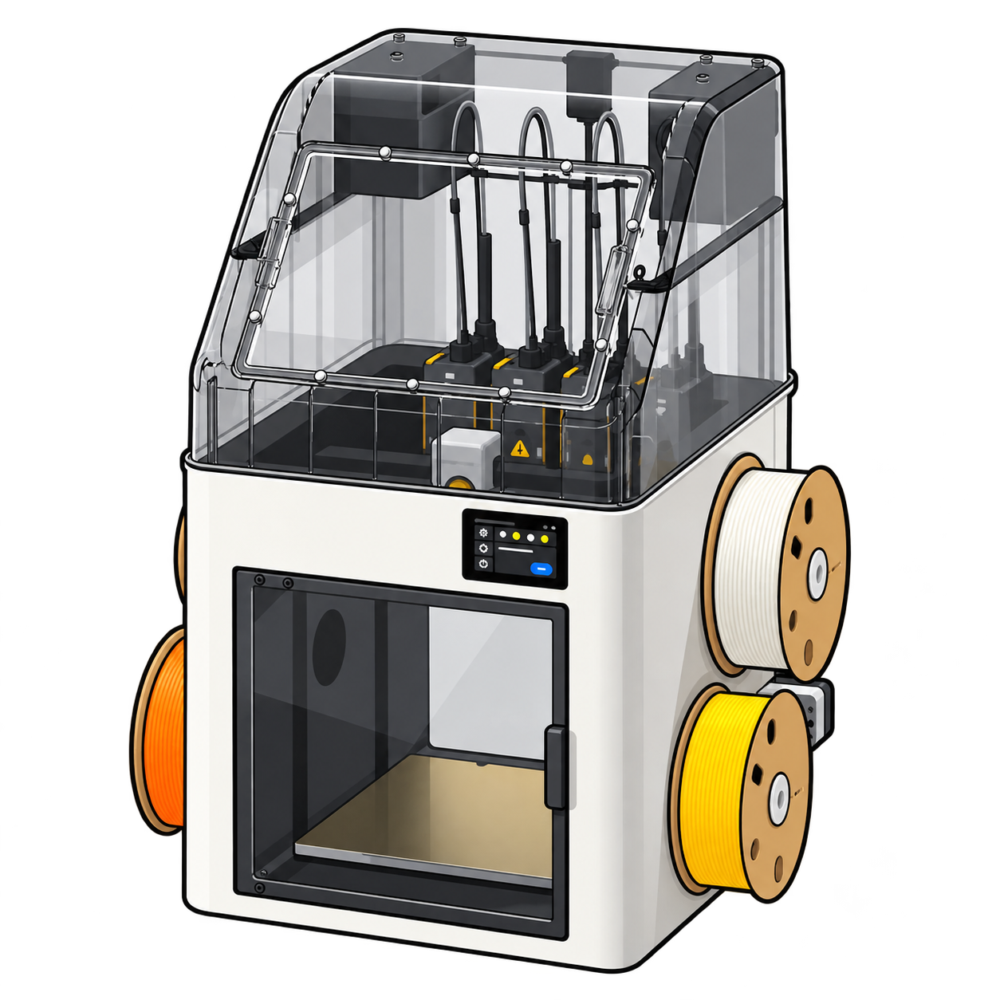

# ioBroker.snapmaker-u1

[](https://www.npmjs.com/package/iobroker.snapmaker-u1)
[](https://github.com/Negalein/ioBroker.snapmaker-u1/actions/workflows/test-and-release.yml)

An ioBroker adapter for monitoring a Snapmaker U1 through its local Moonraker service.

> This is an early development version. It only performs read-only Moonraker health checks and exposes basic printer information. It does not send print, motion, heater, or other control commands.

## Current functionality

### Cameras and print preview

In the settings, open **Discover and select cameras** (German: **Kameras suchen und auswählen**) to retrieve enabled cameras from Moonraker and save a multiple selection. Save the printer host first and keep the adapter running for discovery. No network scan is performed.

Selected cameras are published under `cameras.<Moonraker UID>` with name, enabled flag, stream URL, snapshot URL, service, rotation and mirror settings. The adapter reads camera configuration only; it does not open continuous video streams or claim that a camera is reachable. WebRTC requires a compatible viewer. Historical camera objects remain after deselection but are no longer refreshed.

`printer.job.previewUrl` contains the largest embedded thumbnail of the current G-code file. It is cleared when no file is selected or preview is disabled. Camera/thumbnail failures are logged at debug level and do not mark the printer disconnected. Camera URLs must be reachable from the browser displaying them. This implementation has been checked against the printer's `case`, `Top`, `gui` entries and an existing 300×300 thumbnail; the settings selection still needs an installed Admin test.

Top-cover fan control: write a numeric percentage (0–100, `ack=false`) to `printer.cover.circulation.speed` or `printer.cover.exhaust.speed`. Commands are serialized and acknowledged from a subsequent printer status query. Both fans were live-tested with a five-percentage-point change and restored. Firmware automation may subsequently change fan speeds. Invalid values are rejected.

Enable **Spoolman integration** to read AFC lane material, filament name, color, spool ID, loaded flag and raw status for lanes 0–3, plus the current AFC lane and error flag. Moonraker's Spoolman connection status and active spool ID are exposed under `printer.spoolman`. These values are read through Moonraker; the separate Spoolman URL is reserved for future inventory queries. No spool assignments or consumption reports are written by this adapter.

Read-only status polling has been verified on PAXX12 `2.0.0-paxx12-24`:

- `printer.job`: state, filename, elapsed print duration (seconds), filament used (mm), progress (percent), and paused flag.
- `printer.tools.active`: active extruder name.
- `printer.tools.tool0` through `tool3`: actual temperature, target temperature, and tool status.
- `printer.bed`: actual and target temperature.
- `printer.chamber.temperature`: chamber temperature.

All states are read-only. Missing or invalid values are skipped. Validation so far covers an idle printer; behavior during a live print still needs validation. AFC material information is not synchronized yet.

- Connects locally to Moonraker at a configurable host and port (default: `7125`).
- Publishes `info.connection`, printer hostname, Moonraker version, status, and the last successful update.
- Supports the original firmware and PAXX12 as selectable configuration modes; protocol-specific features will follow after validation against real devices.
- Keeps optional Spoolman connection settings for a later, separate integration.

## Configuration

| Setting | Description |
| --- | --- |
| Moonraker host or IP address | Hostname or local IP address of the printer. Do not include `http://` or a path. |
| Moonraker port | Moonraker HTTP port; `7125` by default. |
| Firmware mode | Auto detect, original firmware, or PAXX12. |
| Request timeout | Maximum duration of one Moonraker request, in seconds. |
| Polling interval | Time between health checks, in seconds. |
| Spoolman | Optional placeholder settings for a later integration. |

## States

| State | Type | Meaning |
| --- | --- | --- |
| `info.connection` | boolean | Whether the latest Moonraker health check succeeded. |
| `printer.info.hostname` | string | Hostname reported by Moonraker. |
| `printer.info.firmware` | string | Moonraker software version. |
| `printer.info.status` | string | Printer state message reported by Moonraker. |
| `printer.info.lastUpdate` | number | Timestamp of the last successful query. |

## Development

Requires Node.js 22.19.0 or newer and ioBroker Admin 7.6.20 or newer. CI covers Node.js 22, 24 and 26.

```bash
npm install
npm run check
npm test
npm run lint
npm run build
```

The repository was generated with the official [`@iobroker/create-adapter`](https://github.com/ioBroker/create-adapter) tooling and uses TypeScript, JSON Config, adapter tests, and GitHub Actions.

## Roadmap

1. Validate the Moonraker payload and capabilities on a physical Snapmaker U1 for both supported firmware variants.
2. Add read-only print, job, and material states with documented state roles.
3. Add carefully scoped control states with correct `ack` handling.
4. Implement Spoolman synchronization after the printer-facing state model is stable.

## Disclaimer

Snapmaker and U1 are trademarks of their respective owners. This is an independent community project and is not affiliated with or endorsed by Snapmaker.

## Changelog

### 0.0.2 (2026-11-02)
- (Negalein) Enable trusted publishing through GitHub Actions after successful checks.

### 0.0.1 (2026-11-01)
- (Negalein) Created the initial adapter scaffold.

## License

Copyright (c) 2026 Negalein <negalein@gmail.com>

Licensed under the [MIT License](LICENSE).
